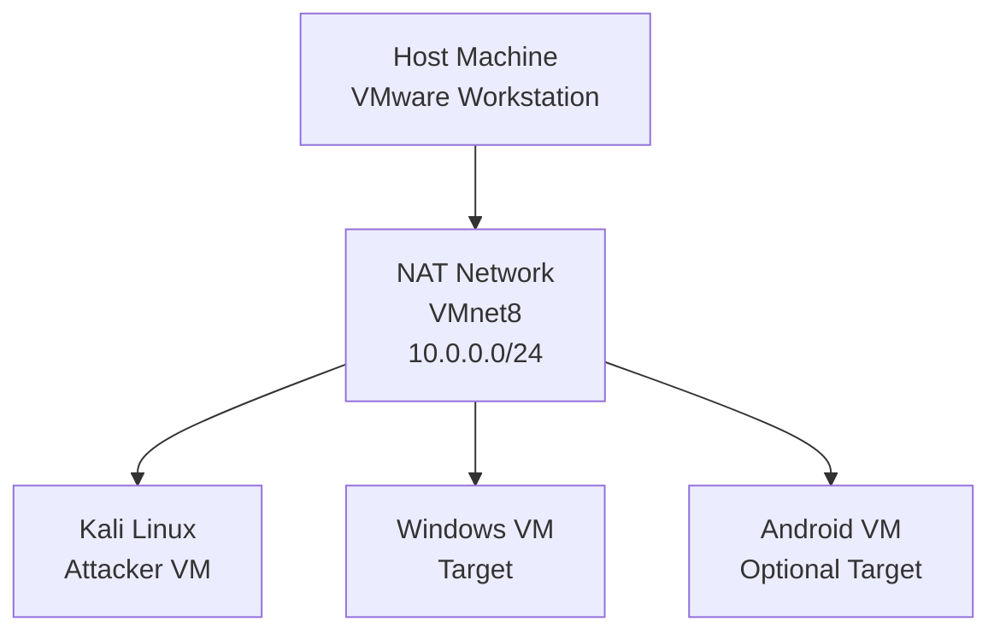
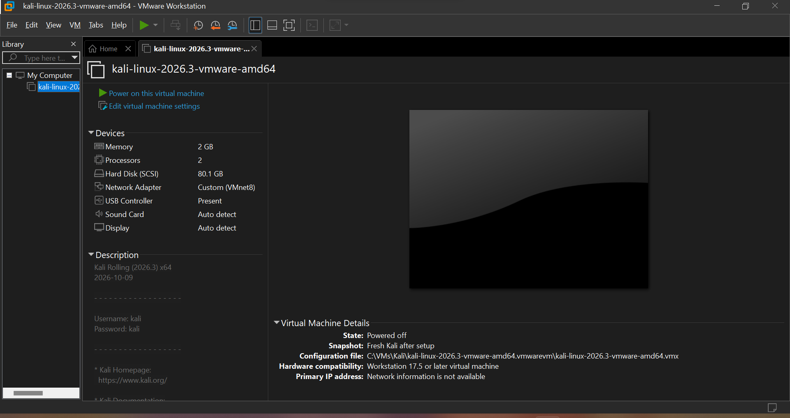
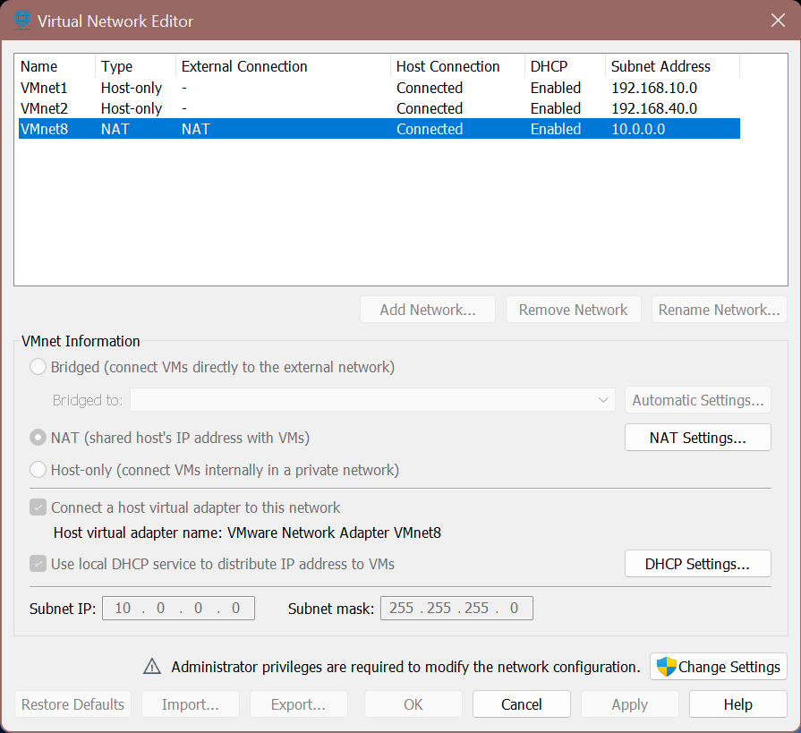
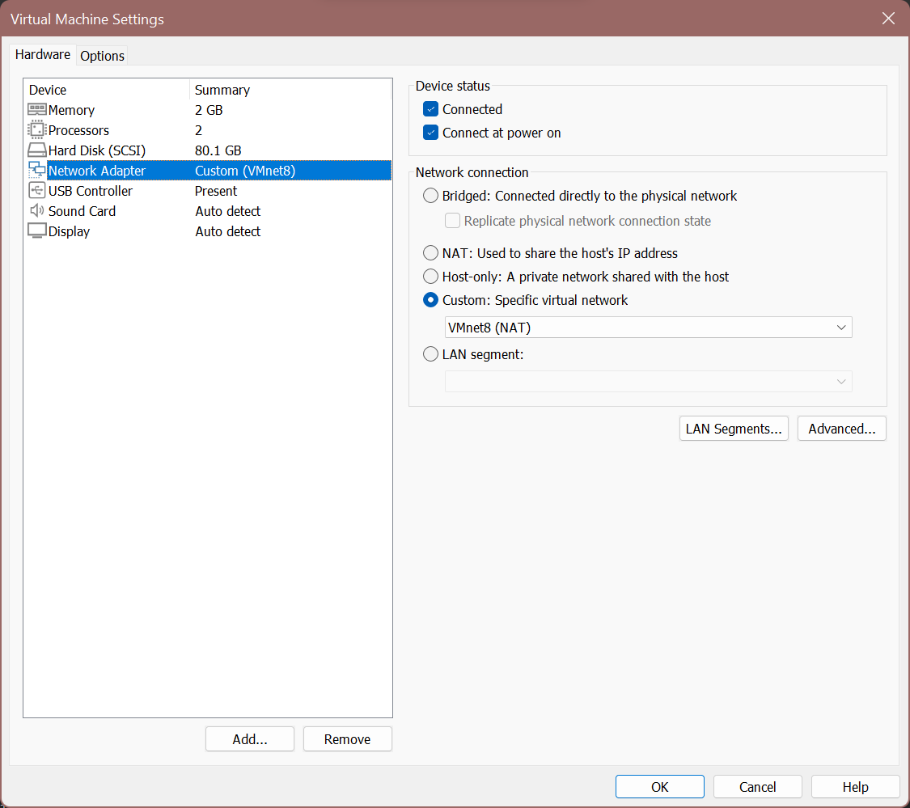
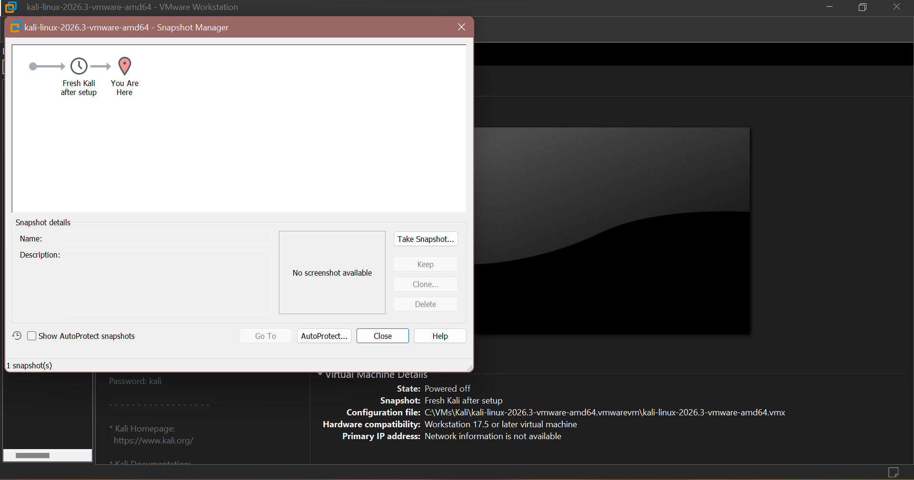
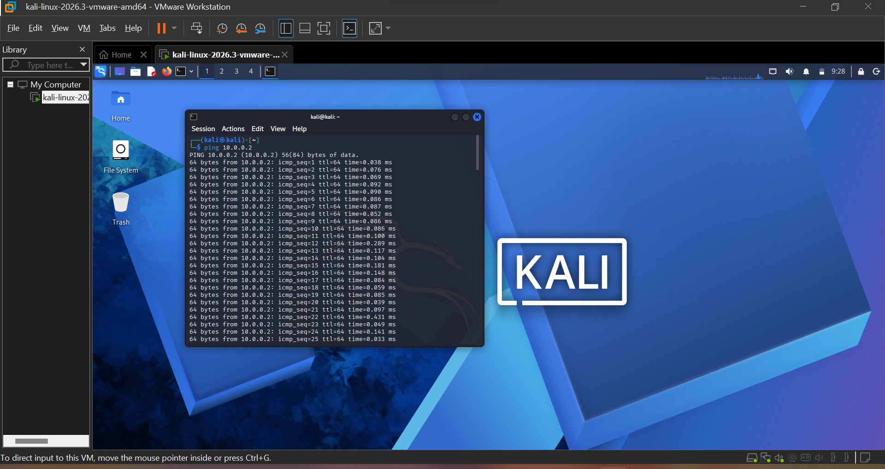

# 🛡️ Cybersecurity & Ethical Hacking Lab

An isolated penetration-testing lab built on **VMware Workstation, Kali Linux, and Windows Virtual Machines**.

<p align="center">
  
  
  
  
  
</p>

---

## 📑 Table of Contents

1. [Overview](#-overview)
2. [Lab at a Glance](#-lab-at-a-glance)
3. [Architecture](#-architecture)
4. [Prerequisites](#-prerequisites)
5. [Setup Guide](#-setup-guide)
6. [Connectivity Verification](#-connectivity-verification)
7. [ Snapshot Strategy](#-snapshot-strategy)
8. [ Troubleshooting](#-troubleshooting)
9. [Skills Demonstrated](#-skills-demonstrated)
10. [Disclaimer](#-disclaimer)
11. [Author](#-author)
12. [References](#-references)

---

## Overview

This project documents the design and deployment of a self-contained cybersecurity practice environment.

The lab provides a safe and repeatable space to learn network configuration, ethical hacking techniques, and penetration testing without affecting production systems.

All virtual machines run on a private NAT network, allowing experiments to remain contained. The environment can also be restored to a known-good state using VMware snapshots.

### Key Outcomes

- Isolated lab network with a custom `10.0.0.0/24` NAT subnet.
- Kali Linux attacker machine configured and verified.
- Windows target machines prepared for security testing.
- Connectivity testing between virtual machines.
- Snapshot-based rollback workflow for safe experimentation.

---

## Lab at a Glance

| Component | Details |
|---|---|
| Hypervisor | VMware Workstation (Pro / Player) |
| Attacker Machine | Kali Linux |
| Target Machines | Windows 10 / 11 / 7 |
| Optional Target | Android VM |
| Network Type | NAT (VMnet8) |
| Subnet | `10.0.0.0/24` |
| Subnet Mask | `255.255.255.0` |
| Example Address Range | `10.0.0.2 – 10.0.0.99` |
| Utility | 7-Zip (archive extraction) |

---

## Architecture

The lab consists of one host machine running VMware Workstation. Multiple virtual machines connect to the same NAT network.



All virtual machines are connected to the same NAT segment. This allows them to communicate with each other and access the Internet through the host's NAT service, subject to firewall and VMware network configuration.

---

## Prerequisites

Before setting up the lab, make sure the following requirements are met:

- A host machine with virtualization enabled in BIOS/UEFI (Intel VT-x or AMD-V).
- VMware Workstation installed.
- 7-Zip installed for extracting downloaded virtual machine archives.
- Kali Linux VMware image.
- Windows virtual machine images.
- Administrator privileges on the host machine for editing virtual network settings.

---

## Setup Guide

### Phase 1: Kali Linux Setup

#### 1. Install 7-Zip

Install 7-Zip to extract downloaded virtual machine archives, such as the Kali Linux `.7z` image.

#### 2. Install VMware Workstation

Install VMware Workstation on the host machine and restart the system if prompted.



#### 3. Configure the NAT Network

Open VMware Workstation and navigate to:

`Edit → Virtual Network Editor → Change Settings`

Configure the NAT network with the following settings:

| Setting | Value |
|---|---|
| Network | VMnet8 (NAT) |
| Subnet IP | `10.0.0.0` |
| Subnet Mask | `255.255.255.0` |

Apply the changes.

#### 4. Import Kali Linux

1. Extract the Kali Linux archive using 7-Zip.
2. Open VMware Workstation.
3. Select `File → Open`.
4. Browse to the extracted folder.
5. Select the `.vmx` file.
6. Open the virtual machine.

#### 5. Configure Kali Networking

1. Open the Kali Linux virtual machine settings.
2. Select **Network Adapter**.
3. Choose **NAT (VMnet8)**.
4. Start Kali Linux.
5. Verify that Kali receives an IP address within the configured subnet.
   


Use the following command:

```bash
ip addr
```



#### 6. Take a Baseline Snapshot

Create a snapshot after completing the initial Kali Linux setup.

Navigate to:

`VM → Snapshot → Take Snapshot`

This snapshot will serve as a restore point before performing security experiments.

---



## Connectivity Verification

Connectivity between virtual machines can be tested using the ICMP `ping` command.

### From Kali Linux

```bash
ping 10.0.0.1
```

### Result



**Important:** Windows Firewall may block incoming ICMP echo requests by default. Therefore, a ping timeout does not always indicate a network configuration problem. Check the target firewall settings before troubleshooting the network.

---

## 📸 Snapshot Strategy

Snapshots provide restore points that make experimentation safer and easier.

Recommended snapshots:

| Snapshot | When to Take It |
|---|---|
| Fresh Install | Immediately after installing the operating system. |
| Network Configured | After verifying IP and NAT settings. |
| Kali Configured | After installing tools and completing updates. |
| Target Ready | After preparing the target virtual machine. |
| Pre-Exploitation | Immediately before an authorized security testing exercise. |

---

## Troubleshooting

| Problem | Suggested Fix |
|---|---|
| No Internet on Kali 2026.1 or later | Try `sudo nmcli connection modify "eth0" ipv4.dad-timeout 0`, then reconnect the interface. |
| Internet issues persist | Verify the NAT gateway. The lab guide suggests checking `10.0.0.1`. |
| VMs cannot ping each other | Ensure all adapters use the same NAT network and check guest firewall settings. |
| Wrong IP range on a VM | Recheck subnet settings in Virtual Network Editor and renew the VM's IP address. |
| Virtual Network Editor is read-only | Click **Change Settings** and approve the administrator prompt. |

---

## Skills Demonstrated

Through this project, the following technical skills were practiced:

- Virtualization using VMware Workstation.
- Virtual machine deployment and management.
- Kali Linux and Windows VM configuration.
- NAT network configuration and IPv4 addressing.
- Network troubleshooting and connectivity testing.
- Snapshot-based backup and recovery.
- Preparing isolated environments for ethical hacking and CTF practice.

---

## Roadmap

### Completed

- [x] Install VMware Workstation and 7-Zip.
- [x] Configure custom NAT network.
- [x] Deploy and configure Kali Linux.
- [x] Configure Windows virtual machines.
- [x] Verify connectivity and create snapshots.

### Upcoming

- [ ] Network reconnaissance labs.
- [ ] Vulnerability assessment labs.
- [ ] Web application security testing.
- [ ] Digital forensics exercises.
- [ ] CTF challenges with additional offline virtual machines.

---

## Disclaimer

This repository is intended strictly for educational purposes and authorized security testing.

Only test systems and networks that you own or have explicit written permission to assess.

The author accepts no responsibility for any misuse of the information or techniques documented in this repository.

---

## Author

**Mustabshira Rehman**

Cybersecurity & IT Student  
Cybersecurity B084

**Interests:**
- Cybersecurity
- Ethical Hacking
- Network Security
- Networking

---

## References

- *Practical Lab Environment Setup for Pentesting, Ethical Hacking & Cybersecurity* — NetworkWalks Academy.
- Lab configuration adapted from VirtualBox to VMware Workstation.

---

If you find this project useful, feel free to explore the repository and follow its progress.
